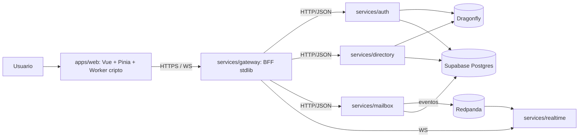

# Arquitectura de Bina Mail

## Diagrama de contenedores

## Flujo de sesion

1. Registro e inicio de sesion van directos a Supabase Auth desde el cliente (REST con la clave anon); la contrasena nunca pasa por los servicios de Bina Mail.
2. El cliente entrega el JWT de Supabase al gateway (POST /api/v1/auth/session); auth lo verifica (HS256) y emite un token de sesion opaco de 30 minutos.
3. Solo el hash SHA-256 del token se persiste en la tabla sessions; el servidor nunca guarda el token en claro y puede revocarlo por hash.
4. El gateway valida cada peticion consultando el hash hacia auth e inyecta el usuario autenticado en la cabecera interna X-Bina-User.

## Flujo de envio de un mensaje

1. El cliente deriva la KEK desde la frase de contrasena (Argon2id) en el Web Worker y descifra su clave privada de identidad (X25519).
2. Genera una clave efimera por mensaje, cifra el mensaje con XChaCha20-Poly1305 y envuelve la clave efimera para cada destinatario (X25519 + HKDF-SHA256).
3. Envia el sobre al gateway por HTTPS. El gateway valida autenticacion e input y reenvia por HTTP/JSON (ADR-007) a mailbox.
4. mailbox persiste el sobre en Postgres (Supabase) y publica el evento mailbox.envelope.stored en Redpanda.
5. realtime consume el evento y emite una senal WS al destinatario conectado, sin contenido ni metadatos.
6. El destinatario recupera el sobre, desenvuelve la clave efimera y descifra en su Web Worker; BLAKE3 verifica la integridad.

## Fronteras declaradas

- El cliente web solo se comunica con services/gateway.
- Los servicios se comunican entre si por HTTP/JSON interno (ADR-007); packages/contracts sigue siendo el contrato canonico y gRPC se reevalua en Fase 3.
- Los eventos solo viajan por Redpanda; consumidores idempotentes.
- El cache Dragonfly nunca almacena contenido de mensajes.
- Supabase con RLS activo; el servidor usa un rol de servicio de menor privilegio.
- Zero-trust: mTLS entre servicios; tokens de corta vida; sin red interna de confianza implicita.

## Despliegue (cloud gestionado)

- Supabase: Postgres gestionado.
- Fly.io/Railway: un contenedor por servicio.
- Dragonfly: contenedor dedicado o servicio gestionado.
- Redpanda: serverless gestionado o instancia dedicada.
