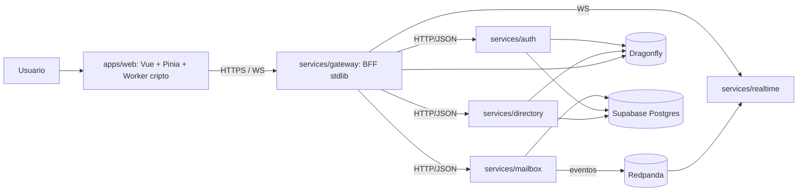

# Arquitectura de Bina Mail

## Diagrama de contenedores

## Flujo de sesion

1. Registro e inicio de sesion van directos a Supabase Auth desde el cliente (REST con la clave anon); la contrasena nunca pasa por los servicios de Bina Mail.
2. El cliente entrega el JWT de Supabase al gateway (POST /api/v1/auth/session); auth lo verifica (HS256) y emite un token de sesion opaco de 30 minutos.
3. Solo el hash SHA-256 del token se persiste en la tabla sessions; el servidor nunca guarda el token en claro y puede revocarlo por hash con DELETE /api/v1/auth/session.
4. El gateway valida cada peticion consultando el hash hacia auth, con cache Dragonfly de 30 segundos por sesion, acotada por la expiracion e invalidada al revocar, e inyecta el usuario autenticado en la cabecera interna X-Bina-User.
5. El limite de uso por usuario es una ventana fija de 60 segundos respaldada por Dragonfly (o memoria); ante error del contador la peticion se admite (fail-open documentado, ADR-002).

## Flujo de envio de un mensaje

1. El cliente deriva la KEK desde la frase de contrasena (Argon2id) en el Web Worker y descifra su clave privada de identidad (X25519).
2. Genera una clave efimera por mensaje, cifra el mensaje con XChaCha20-Poly1305 y envuelve la clave efimera para cada destinatario (X25519 + HKDF-SHA256).
3. Envia el sobre al gateway por HTTPS. El gateway valida autenticacion e input y reenvia por HTTP/JSON (ADR-007) a mailbox.
4. mailbox persiste el sobre en Postgres (Supabase) y publica el evento mailbox.envelope.stored en Redpanda (ADR-008).
5. realtime consume el evento y emite una senal WS al destinatario conectado, sin contenido ni metadatos.
6. El destinatario recupera el sobre, desenvuelve la clave efimera y descifra en su Web Worker; BLAKE3 verifica la integridad.

## Flujo de senal realtime

1. El cliente abre un WS hacia /api/v1/realtime en el gateway, que tiende un tunel hacia realtime; el navegador no puede enviar cabeceras Authorization en un WS, por lo que la autenticacion ocurre dentro del canal.
2. El primer mensaje transporta la sesion opaca: realtime la valida contra auth y resuelve el fingerprint del usuario contra directory; un fallo cierra la conexion con 4401.
3. Tras persistir un sobre, mailbox publica el evento en Redpanda y realtime emite al destinatario la senal sin contenido (ADR-005); el cliente responde consultando su buzon.
4. Keepalive: ping cada 30 segundos y read deadline de 90 segundos.

## Fronteras declaradas

- El cliente web solo se comunica con services/gateway.
- Los servicios se comunican entre si por HTTP/JSON interno (ADR-007); packages/contracts sigue siendo el contrato canonico; gRPC quedo revisado sin defectos en Fase 3 y se reevalua en Fase 5 (DEBT-002).
- Los eventos solo viajan por Redpanda (ADR-008); consumidores idempotentes.
- El cache Dragonfly nunca almacena contenido de mensajes: claves bina:sess (30 segundos), bina:keyfp y bina:keyuser (60 segundos), bina:rl (ventana de 60 segundos).
- Supabase con RLS activo; el servidor usa un rol de servicio de menor privilegio.
- Zero-trust: mTLS entre servicios en Fase 5; tokens de corta vida; sin red interna de confianza implicita.

## Despliegue (cloud gestionado)

- Supabase: Postgres gestionado.
- Fly.io/Railway: un contenedor por servicio.
- Dragonfly: contenedor dedicado o servicio gestionado.
- Redpanda: serverless gestionado o instancia dedicada.
