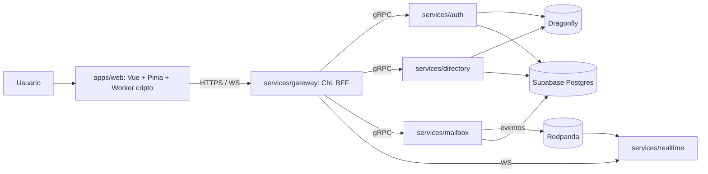

# Arquitectura de Bina Mail

## Diagrama de contenedores

## Flujo de envío de un mensaje

1. El cliente deriva la KEK desde la frase de contraseña (Argon2id) en el Web Worker y descifra su clave privada de identidad (X25519).
2. Genera una clave efímera por mensaje, cifra el mensaje con XChaCha20-Poly1305 y envuelve la clave efímera para cada destinatario (X25519 + HKDF-SHA256).
3. Envía el sobre al gateway por HTTPS. El gateway valida autenticación e input y reenvía por gRPC a mailbox.
4. mailbox persiste el sobre en Postgres (Supabase) y publica el evento mailbox.envelope.stored en Redpanda.
5. realtime consume el evento y emite una señal WS al destinatario conectado, sin contenido ni metadatos.
6. El destinatario recupera el sobre, desenvuelve la clave efímera y descifra en su Web Worker; BLAKE3 verifica la integridad.

## Fronteras declaradas

- El cliente web solo se comunica con services/gateway.
- Los servicios solo se comunican entre sí por gRPC con contratos protobuf versionados (packages/contracts).
- Los eventos solo viajan por Redpanda; consumidores idempotentes.
- El cache Dragonfly nunca almacena contenido de mensajes.
- Supabase con RLS activo; el servidor usa un rol de servicio de menor privilegio.
- Zero-trust: mTLS entre servicios; tokens de corta vida; sin red interna de confianza implícita.

## Despliegue (cloud gestionado)

- Supabase: Postgres gestionado.
- Fly.io/Railway: un contenedor por servicio.
- Dragonfly: contenedor dedicado o servicio gestionado.
- Redpanda: serverless gestionado o instancia dedicada.
